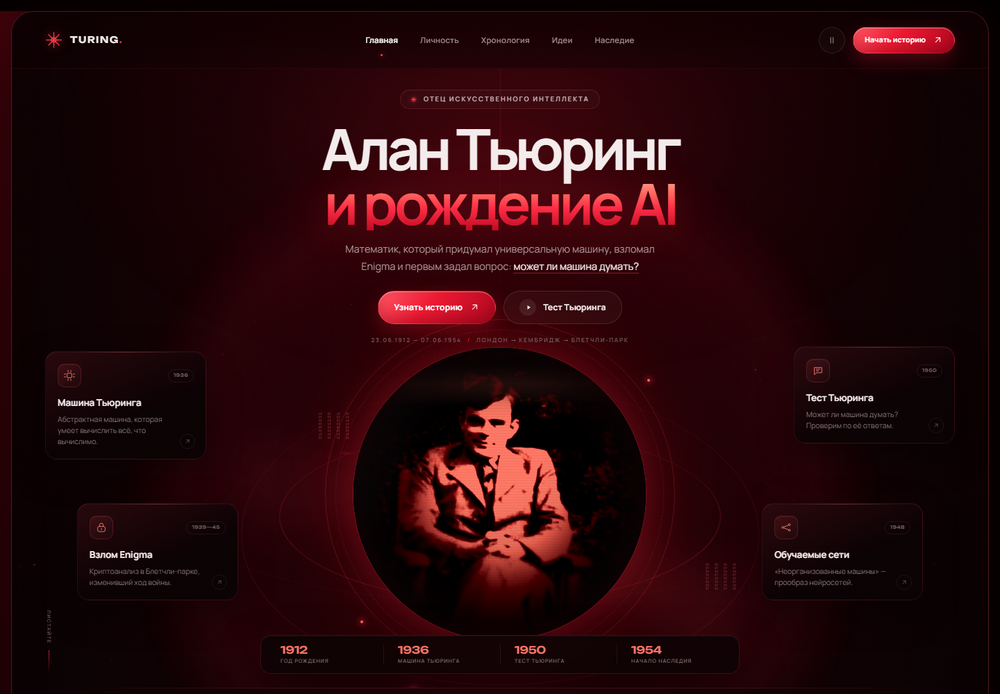

# Алан Тьюринг — человек, который придумал ИИ

Одностраничный сайт-лонгрид о математике, криптоаналитике и пионере искусственного интеллекта Алане Тьюринге. Визуальный язык вдохновлён референсом: тёмная красно-чёрная палитра, центральная цифровая сфера, карточки по краям и панель ключевых дат.



## Запуск

Сборка не нужна. Откройте `index.html` в браузере — двойным щелчком или командой:

```powershell
Start-Process index.html
```

Шрифты и изображения лежат локально, поэтому сайт работает без интернета. Внешние ссылки на источники находятся в подвале.

## Что внутри

- **Hero** — Алан Тьюринг и рождение AI, интерактивная цифровая сфера, четыре карточки-факта и хронологическая панель.
- **Личность** — кто он, чем занимался, ключевые даты и архивный портрет.
- **Хронология** — восемь событий: от рождения в 1912 году до смерти в 1954-м.
- **Идеи** — машина Тьюринга, игра в имитацию, обучаемые машины и морфогенез.
- **Тест Тьюринга** — интерактивная иллюстрация «кто из собеседников машина?».
- **Наследие** — премия Тьюринга, королевское помилование и банкнота £50.

Дополнительно: мобильное меню, кнопка паузы анимации, parallax-эффект сферы, анимация частиц на canvas и мягкое появление секций при скролле.

## Видео

К проекту собран трёхминутный ролик: **«Алан Тьюринг: человек, который заложил основы ИИ»**.

- [Смотреть видео](video/turing-3min.mp4) — 1920×1080, 30 fps, ровно 3:00.
- [Постер](video/poster.jpg) и [обложка](video/thumbnail.jpg).
- [Субтитры](video/subtitles.srt), [сценарий и детали производства](video/README.md).

В ролике: авторская графика в стилистике сайта, русская нейросетевая озвучка, оригинальная ambient-музыка и мягкие русские субтитры.

## Структура

```text
index.html          разметка и контент
styles.css          вся визуальная система и адаптивность
script.js           меню, анимации, canvas и тест Тьюринга
assets/             портрет, цифровая сфера, шрифты, favicon
video/              готовый ролик, постер, субтитры и исходники сборки
preview.png         превью desktop
preview-mobile.png  превью mobile
```

## Источники

- [Alan Turing — Wikipedia](https://en.wikipedia.org/wiki/Alan_Turing)
- [The Turing Digital Archive](https://www.turingarchive.org/)
- [A. M. Turing, «Computing Machinery and Intelligence», Mind, 1950](https://academic.oup.com/mind/article/LIX/236/433/986238)
- [Портрет на Wikimedia Commons](https://commons.wikimedia.org/wiki/File:Alan_Turing_az_1930-as_%C3%A9vekben.jpg) — общественное достояние.

Изображение сферы — художественная обработка архивного портрета, созданная для этого проекта. Сайт носит образовательный характер.
